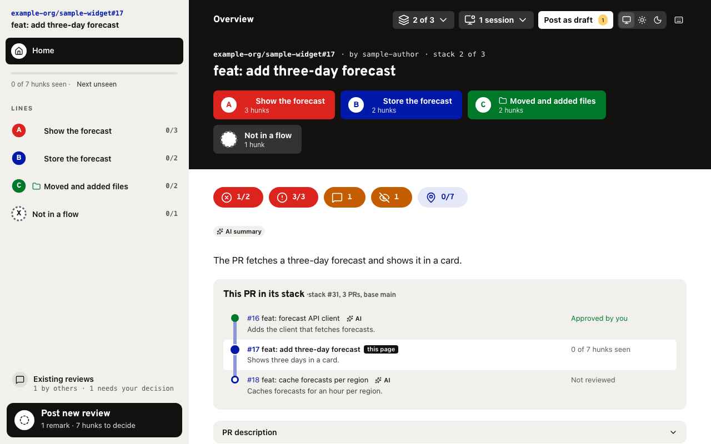
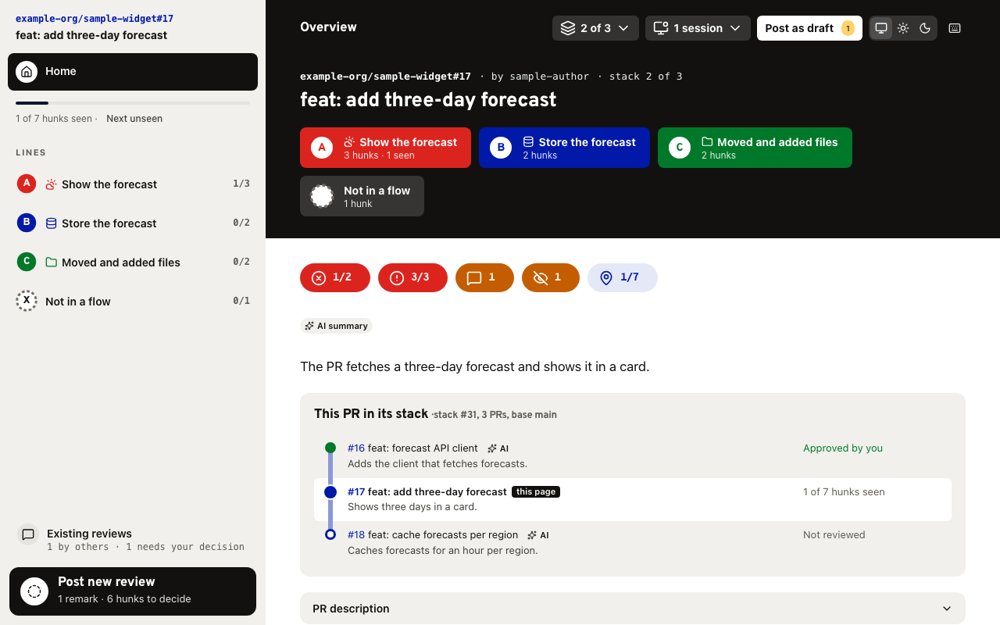
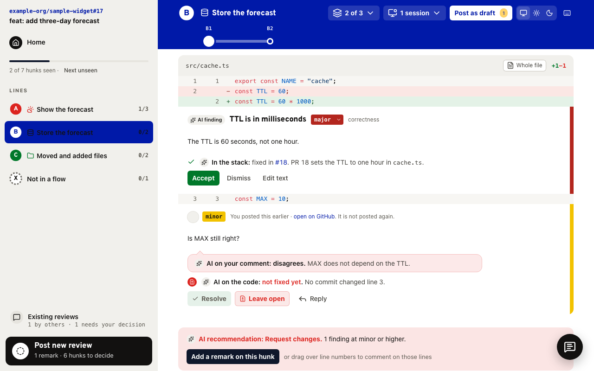
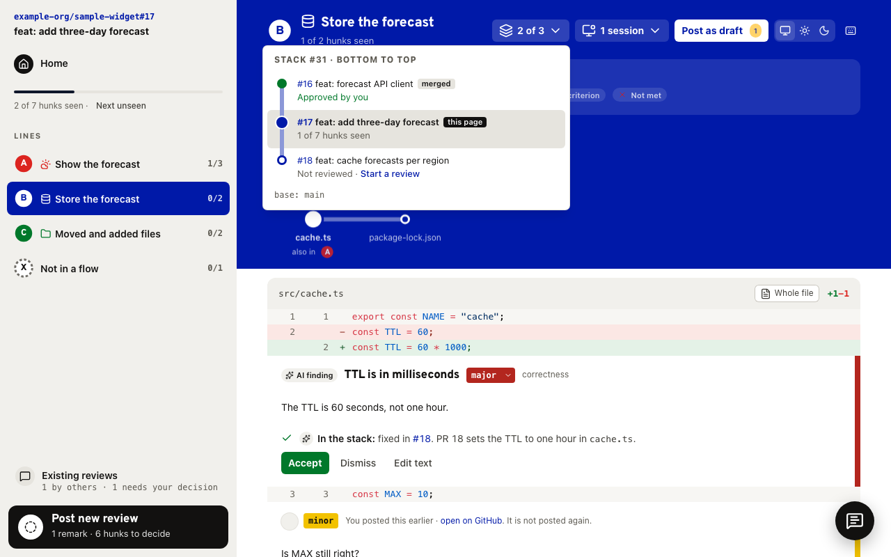
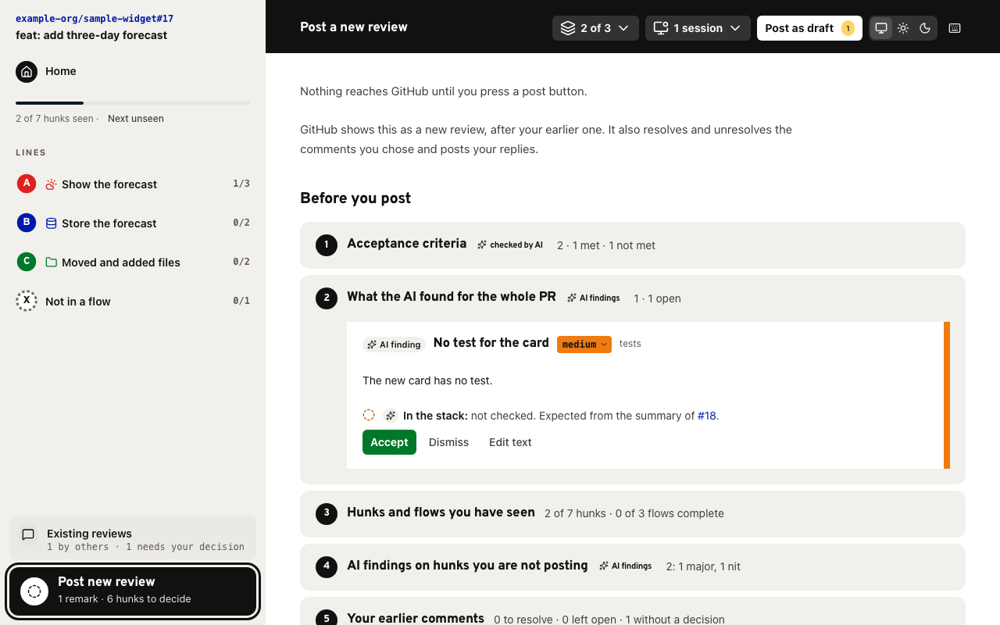

# skills

This repo contains [Agent Skills](https://agentskills.io) that I created for my own development workflow. My personal preferences shine through: I use AI as a supplement, but I prefer to stay in control, understand what it is doing, and have it work the way I work.

You may find these skills useful for your workflows too. If you end up using them, I'd love to know. And if you have suggestions, please open an [issue](https://github.com/FreekVR/skills/issues) or a pull request 🙂

The skills use the open `SKILL.md` format, so they work in Claude Code, Codex, pi, Mistral Vibe and other harnesses that support it.

## Skills

| Skill | Category | What it does |
| ----- | -------- | ------------ |
| [guided-pr-review](skills/guided-pr-review) | Review/verification | Walks you through a GitHub pull request, flow by flow, with AI findings that you decide on before anything is posted. |

## guided-pr-review

A pull request on GitHub is a list of files in path order. You read them, try to keep the whole change in your head, and hope you did not miss the part that matters. AI review tools do the opposite: they read everything for you and drop a pile of comments on the PR.

guided-pr-review sits between the two. Ask your agent to "guide me through PR 123". The agent reads the PR, its tickets and the earlier reviews, and opens a review page on your own computer. You do the review. The AI shows you the way and gives you a second opinion.



- **Read the change as flows, not as files.** The agent groups every hunk into flows through the code, like lines on a metro map. You follow one flow from where it starts to where it ends, and the map shows which stops you saw.
- **AI findings that you decide on.** Each finding has a severity that you can change, and you accept, dismiss or edit it. Nothing reaches GitHub until you press a post button, as a draft or as your final review.
- **Acceptance criteria, checked.** The agent checks the PR against the acceptance criteria of its tickets. Each flow shows the criteria it should meet, and a criterion that is not met becomes a finding.
- **Earlier reviews, with a second opinion.** For every comment, yours and your colleagues', the AI says whether it agrees and whether the code fixed it. You resolve, unresolve and reply from the same page.
- **Stacked pull requests.** Review one PR of a GitHub stack with the rest of the stack as context. Each finding says whether another PR in the stack fixes it or makes it worse, and you start the review of the next PR from the header.
- **Ask about any hunk.** Ask the agent a question about the code in front of you, and turn the answer into a remark in your review.
- **One page for all your reviews.** One local server serves every open review, grouped by repository. The agent stops after 30 minutes without requests, and you resume the review later.

| Home | A hunk with an AI finding |
| ---- | ------------------------- |
|  |  |
| **The stack** | **Before you post** |
|  |  |

The screenshots show a made-up pull request. The skill needs Node.js, git, read and write access to GitHub, and a browser on the same computer.

## Installation

### With npx skills

The easiest route is the [`skills`](https://skills.sh) CLI. It needs Node.js.

```bash
# Pick skills and harnesses interactively
npx skills add FreekVR/skills

# One skill, one harness
npx skills add FreekVR/skills --skill <skill-name> -a claude-code

# Available in all your projects
npx skills add FreekVR/skills -g
```

Keep them current with `npx skills check` and `npx skills update`.

Some skills build a web page on your computer the first time you use them and after each update, with pnpm. Any pnpm works: it switches to the version the skill names. The agent asks before it installs or builds.

### Manually

Copy or symlink a folder from `skills/` into your harness's skills directory, for example `.agents/skills/`, `.claude/skills/` or `.vibe/skills/`.

## Contributing

Every skill and contribution follows the rules in [AGENTS.md](AGENTS.md).

### Layout

```
skills/
  <skill-name>/
    SKILL.md        # frontmatter + instructions
    tests/
      triggers.md   # prompts that should and should not load the skill
    scripts/        # optional: code the agent runs
    references/     # optional: docs the agent reads on demand
    assets/         # optional: templates and static files
```

## License

[MIT](LICENSE)
